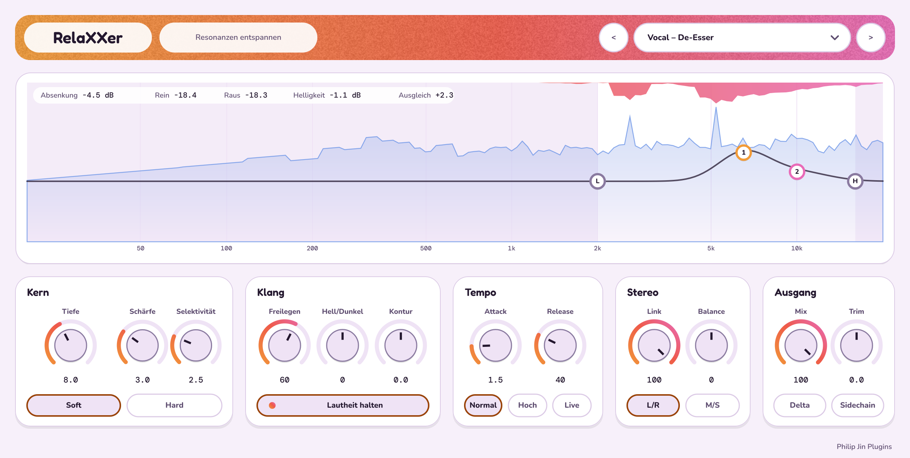

# RelaXXer – dynamischer Resonanz-Unterdrücker

von **Philip Jin Plugins** · Audio Unit (Logic) + VST3 · macOS (Apple Silicon + Intel)

RelaXXer findet harsche, schrille oder dröhnende Resonanzen automatisch und senkt sie nur dann und nur dort ab, wo sie gerade auftreten. Der Rest des Klangs bleibt unberührt. Eigenentwicklung, nicht von oeksound.

## Installieren

1. Reiter *Actions* -> letzten grünen Lauf öffnen -> unten bei *Artifacts* `RelaXXer-macOS` laden und entpacken.
2. `RelaXXer.component` nach `~/Library/Audio/Plug-Ins/Components/`, `RelaXXer.vst3` nach `~/Library/Audio/Plug-Ins/VST3/` (im Finder: Cmd + Shift + G).
3. Terminal (wichtig, sonst blockt macOS das Plugin):

       xattr -dr com.apple.quarantine ~/Library/Audio/Plug-Ins/Components/RelaXXer.component
       xattr -dr com.apple.quarantine ~/Library/Audio/Plug-Ins/VST3/RelaXXer.vst3
       killall -9 AudioComponentRegistrar

4. Logic: Einstellungen -> Plug-in-Manager -> Zurücksetzen & neu scannen. Zu finden unter Audio Units -> Philip Jin Plugins -> RelaXXer.

## So arbeitest du damit

Tipp: Bleib mit der Maus kurz über einem Regler, Schalter oder Knoten stehen, dann erscheint eine kurze Erklärung.

1. Preset wählen (z. B. „Vocal – Härte weg").
2. **Tiefe** hochdrehen, bis es zu viel wird, dann ein Stück zurück.
3. **Delta** an: du hörst nur, was entfernt wird. Mit den Knoten **1** und **2** im Spektrum die Problemzone empfindlicher (hoch ziehen) oder unempfindlicher (runter) machen. Delta wieder aus.
4. **Schärfe** für schmale, tiefe Kerben (Klingeln, Pfeifen) oder breite, sanfte (allgemeine Härte). **Selektivität** hoch = nur die markantesten Resonanzen.

| Bedienelement | Funktion |
|---|---|
| Tiefe | Stärke der Absenkung (0–20) |
| Schärfe | breite/weiche (0) bis schmale/tiefe (10) Kerben |
| Selektivität | wie wählerisch die Erkennung ist (hoch = nur markante Resonanzen) |
| Soft / Hard | Soft: transparent, pegelunabhängig. Hard: kräftiger, reagiert stärker auf laute Stellen |
| Attack / Release | Reaktionszeit (Referenz bei 1 kHz; Höhen reagieren schneller, Bässe langsamer) |
| Normal / Hoch / Live | Hoch = feinere Zeitauflösung (Drums, Busse). Live = nur ~5 ms Latenz zum Einspielen/Monitoring, gröberes Frequenzraster |
| L/R, M/S, Link, Balance | Stereo-Bearbeitung: gekoppelt (Link 100 %) oder getrennt; Balance verteilt die Wirkung |
| Freilegen | hebt verdeckte, zu leise Bereiche behutsam an (max. +6 dB), wie „Recover" bei Gullfoss |
| Hell/Dunkel | Erkennung bevorzugt Tiefen (+, Ergebnis heller) oder Höhen (−, dunkler), wie „Brighten" |
| Kontur | Lautheitskontur: + = mehr Bass und Höhen, weniger Mitten (wie „Boost") |
| Lautheit halten | gleicht die wahrgenommene Lautheit automatisch aus (fairer A/B-Vergleich) |
| Mix / Trim | Trocken/Nass-Anteil, Pegelausgleich des Nassanteils |
| Delta | nur das Entfernte hören |
| Sidechain | externes Signal steuert die Erkennung (Logic: Plugin-Fenster oben rechts "Side Chain") |
| Spektrum-Knoten | **L**/**H**: Arbeitsbereich, **1**/**2**: Empfindlichkeit (ziehen), Mausrad = Breite (Q), Doppelklick = zurücksetzen |

17 Presets: Standard, Vocal (Härte, De-Esser, nasal), Akustik-/E-Gitarre, Bass, Overheads, Snare, Synth, Mix-Bus (sanft, Klarheit), Mastering (hauchzart, Kontur), Vocal live, Sidechain.

Oben im Spektrum: Absenkung, Pegel rein/raus, Helligkeits-Änderung und automatischer Ausgleich.

## Technik

- STFT mit sqrt-Hann-Fenster, 75 % (Normal) oder 87,5 % (Hoch) Überlappung, ~21 ms Fenster bei jeder Samplerate; Latenz 1024 Samples bei 44,1/48 kHz (wird an Logic gemeldet und ausgeglichen).
- Resonanz = wie weit ein Frequenzbereich über der geglätteten Spektral-Hüllkurve (~1 Oktave, robust gegen Spitzen) liegt, gewichtet mit der Fokus-Kurve.
- Absenkung mit weichem Knie (Soft) bzw. linear und pegelabhängig (Hard), über die Frequenz geglättet (Schärfe), Attack/Release je Frequenz.
- Mix, Trim und Delta werden im Spektrum berechnet: perfekt phasengleich, keine Kammfilter.
- Auf dem Mac rechnet die FFT über Apple vDSP.

## Sicherheit

Kein Datei- oder Netzwerkzugriff. NaN/Inf-Schutz an allen Eingängen, harte Ausgangsbegrenzung auf +12 dBFS, keine Speicher-Allokation im Audio-Thread. Die automatischen Tests prüfen u. a. Transparenz (Fehler < -130 dB bei Tiefe 0), Delta + Normal = Original und einen Fuzz-Test mit NaN/Inf, Riesenpegeln und Extremwerten bei 8–192 kHz.

    g++ -std=c++17 -O2 -fsanitize=address,undefined -ISource Tests/dsp_test.cpp -o dsp_test && ./dsp_test

## Lizenzen

Schriften Fredoka, Nunito und DM Mono: SIL Open Font License (siehe `Resources/Fonts/`). JUCE: AGPLv3 bzw. JUCE-Lizenz.
